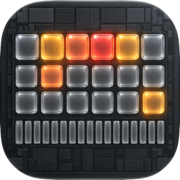
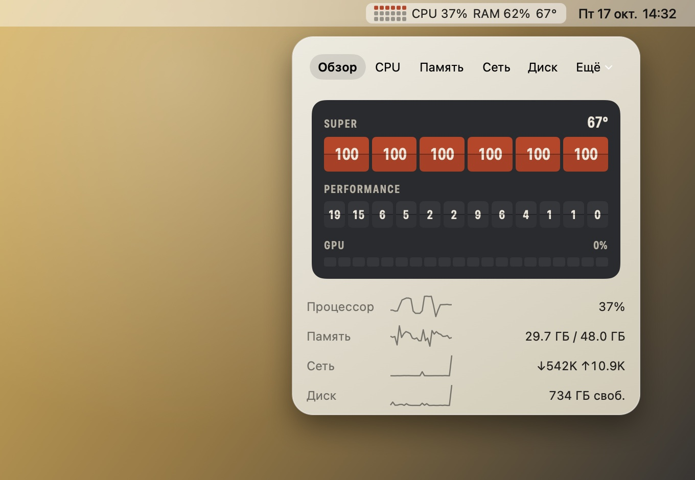
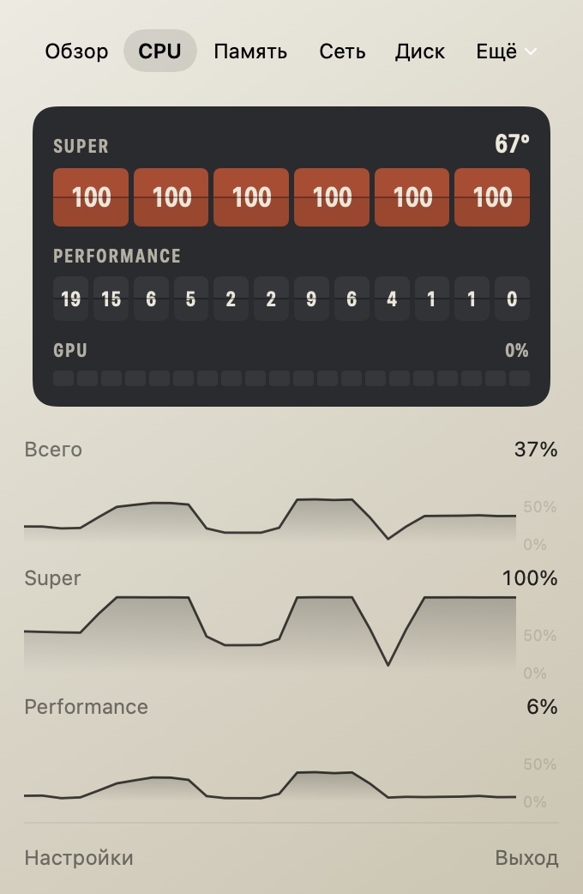
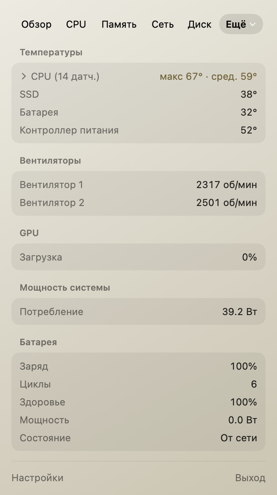
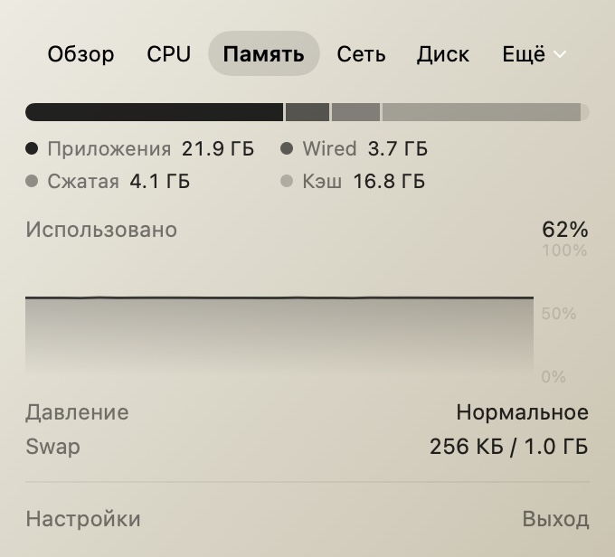
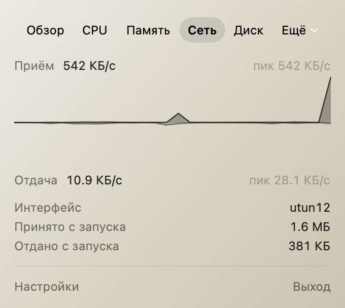
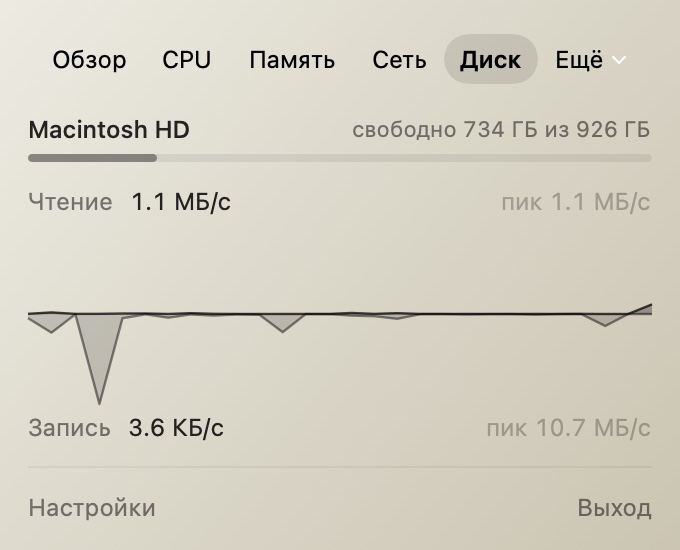

<p align="center">
  
</p>

<h1 align="center">Ochre</h1>

<p align="center">
  <b>See your Mac's chip at work, right from the menu bar.</b><br>
  Every CPU core and GPU core on a live die map that heats up with the load.
</p>

<p align="center">
  <a href="https://github.com/aesarva/ochre/releases/download/v1.1.1/Ochre-1.1.1.dmg"></a>
</p>

<p align="center">
  macOS 26 Tahoe or later · Apple Silicon and Intel · signed and notarized · free and open source
</p>

<p align="center">
  <b>English</b> · <a href="README.ru.md">Русский</a>
</p>

<p align="center">
  
</p>

## Highlights

- **The real chip, not an average.** Cores are drawn the way your processor is built: grouped by cluster (Super and Performance on M5, Performance and Efficiency on M1–M4), each with its own load, plus a strip of GPU cores. One runaway thread is obvious at a glance.
- **Colour means heat.** The interface is graphite and paper. Colour shows up only where something is working hard: amber, then ember, then red.
- **Light on your Mac.** About 0.5% of one core and 14 MB of memory with the panel closed (measured on an M5 Pro). Ochre slows its sampling down when you aren't looking.
- **Native.** Swift, SwiftUI and AppKit with Liquid Glass. No Electron, no helper daemon, no administrator password, no kernel extension.
- **Private.** No analytics, no account. The only network request is a daily update check against GitHub; it sends no system data and can be turned off in Settings.
- **Alerts that wait.** A threshold has to hold for as long as you choose before you get a notification, so short spikes stay quiet.

## Screenshots

<table>
  <tr>
    <td width="50%" valign="top"><br><b>CPU</b>: die map, clusters and load history</td>
    <td width="50%" valign="top"><br><b>Sensors</b>: temperatures, fans, power and battery</td>
  </tr>
</table>

<table>
  <tr>
    <td width="33%" valign="top"><br><b>Memory</b></td>
    <td width="33%" valign="top"><br><b>Network</b></td>
    <td width="33%" valign="top"><br><b>Disk</b></td>
  </tr>
</table>

## Features

**Menu bar.** Build the item from the segments you need: mini die map, CPU graph, CPU %, memory %, temperature and network speed. Segments keep a fixed width, so the menu bar doesn't jitter, and a segment turns red while its alert is active.

<picture>
  <source media="(prefers-color-scheme: dark)" srcset="docs/images/menubar-dark.png">
  
</picture>

**CPU and GPU.** One split-flap tile per core that flips when its load changes. Each cluster shows its temperature, and the whole CPU and every cluster have their own load history. GPU cores sit in a strip below.

**Memory.** App, wired, compressed and cached memory on one bar, plus usage history, memory pressure and swap.

**Network and disk.** Download and upload speed with peaks and history, the active interface and traffic since launch. Free space on the startup disk and read/write speed.

**Sensors.** Every temperature sensor grouped by part (CPU, SSD, battery, power), fan speeds, GPU load, total system power, and battery charge, cycles and health.

**Processes.** The busiest processes by CPU or memory. Click a row to copy its PID.

**Alerts.** CPU temperature, CPU load, memory pressure and low disk space. Pick a threshold and how long it has to hold, for example 95 °C for 30 seconds.

**Updates.** Ochre checks for a new version once a day. When one is out, a dot appears on the menu bar item and the panel offers **Install and Relaunch**: one click downloads it, verifies its signature, replaces the app and starts the new version.

**Settings.** Refresh every 1, 2 or 5 seconds, launch at login, and automatic update checks.

## Install

1. [Download the DMG](https://github.com/aesarva/ochre/releases/download/v1.1.1/Ochre-1.1.1.dmg) (7 MB). Older versions are on the [Releases](../../releases) page.
2. Open it and drag **Ochre** to **Applications**.
3. Launch Ochre. It appears in the menu bar only, with no Dock icon. Click it to open the panel. Settings (gear) and Quit (power) are at the bottom.

If you turn alerts on, macOS asks once for permission to show notifications. Ochre needs no other permissions.

> [!NOTE]
> The interface is in Russian for now.

**Uninstall:** turn off *Launch at login* in Settings, quit Ochre, and move it to the Trash. To remove its settings too, run `defaults delete com.alexsarva.Ochre`.

## FAQ

<details>
<summary><b>Why isn't Ochre on the Mac App Store?</b></summary>

Temperatures, fans and power come from IOHID and the SMC. These are private macOS interfaces, and the App Store sandbox doesn't allow them. Ochre is distributed directly, signed with a Developer ID certificate and notarized by Apple.
</details>

<details>
<summary><b>Does it work on Intel Macs?</b></summary>

Yes, the app is universal. Intel Macs have no HID temperature sensors, so CPU temperatures aren't shown there. Fans and power are still read from the SMC.
</details>

<details>
<summary><b>Will it drain my battery?</b></summary>

No. With the panel closed Ochre samples at your chosen interval and reads temperatures every 15 seconds. Faster sampling (temperatures every 2 seconds, plus the process list) runs only while the panel is open.
</details>

<details>
<summary><b>How do I update?</b></summary>

Ochre checks once a day and shows the update in its panel; click **Install and Relaunch**. You can also check now in Settings → General. Version 1.0.0 has no updater yet, so update it once by downloading the new DMG. Run Ochre from Applications: when it is opened straight from the disk image, it can't update itself and says so.
</details>

<details>
<summary><b>Why are some processes missing?</b></summary>

Processes owned by root or other users can't be inspected without elevated rights, and Ochre never asks for them.
</details>

<details>
<summary><b>A sensor shows a strange name or is missing.</b></summary>

Sensor names and availability vary between Mac models, and macOS updates can change them. Please [open an issue](../../issues) with your Mac model and a screenshot of the Sensors tab.
</details>

## How it works

| Metric | Source |
| --- | --- |
| Per-core CPU load | `host_processor_info` |
| Core clusters | `hw.nperflevels`, `hw.perflevel*` sysctls |
| GPU load and core count | IORegistry `IOAccelerator` statistics |
| Memory, pressure, swap | `host_statistics64`, `kern.memorystatus_vm_pressure_level`, `vm.swapusage` |
| Network | `NET_RT_IFLIST2` interface counters |
| Disk | `IOBlockStorageDriver` statistics, volume capacity |
| Temperatures (Apple Silicon) | IOHID event system sensors |
| Fans, power, Intel sensors | SMC |
| Battery | `AppleSmartBattery` |
| Processes | `proc_pid_rusage`, `proc_pidpath` |

```
Sources/
  CPrivateAPI/   C declarations for IOHID and SMC
  MetricsCore/   collectors, sampling, history, alerts, presentation (unit-tested)
  Ochre/         menu bar item, panel, settings, notifications
Tests/           MetricsCoreTests
scripts/         build-app.sh, release.sh
site/            landing page (EN/RU)
```

## Build from source

You need macOS 26 and Xcode 26 (Swift 6.2).

```sh
git clone https://github.com/aesarva/ochre.git
cd ochre
scripts/build-app.sh                # universal build/Ochre.app
ARCHS=arm64 scripts/build-app.sh    # Apple Silicon only, faster
open build/Ochre.app
```

Run the tests with `swift test`. If `xcode-select` points to the Command Line Tools, prefix it with `DEVELOPER_DIR=/Applications/Xcode.app/Contents/Developer`.

## Contributing

Bug reports and pull requests are welcome. Branching, commit style, debug options and the release process are described in [CONTRIBUTING.md](CONTRIBUTING.md).

## License

[MIT](LICENSE) © 2026 Alex Sarva. The landing page bundles Golos Text and Fira Sans Condensed under the SIL Open Font License ([`site/fonts`](site/fonts)).
